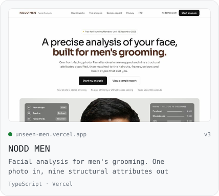
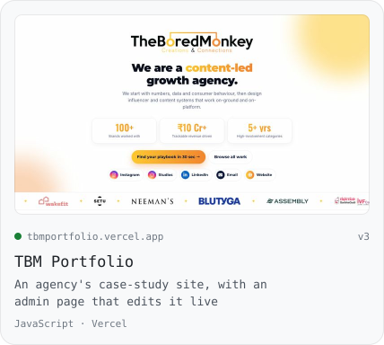
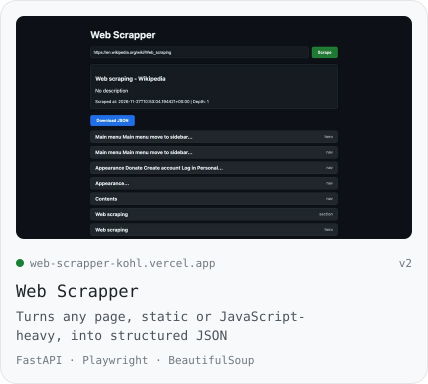
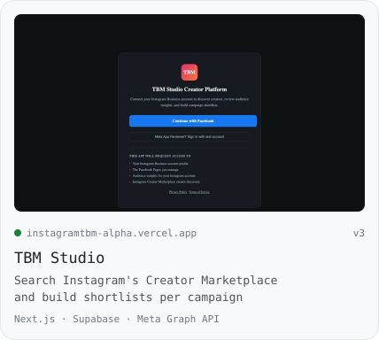

<picture>
  <source media="(prefers-color-scheme: dark)" srcset="./assets/changelog-dark.svg">
  
</picture>

## Selected work

<a href="https://unseen-men.vercel.app"><picture><source media="(prefers-color-scheme: dark)" srcset="./assets/work/unseen-men-dark.svg"></picture></a>
<a href="https://tbmportfolio.vercel.app"><picture><source media="(prefers-color-scheme: dark)" srcset="./assets/work/tbm-portfolio-dark.svg"></picture></a>

<a href="https://web-scrapper-kohl.vercel.app"><picture><source media="(prefers-color-scheme: dark)" srcset="./assets/work/web-scrapper-dark.svg"></picture></a>
<a href="https://instagramtbm-alpha.vercel.app"><picture><source media="(prefers-color-scheme: dark)" srcset="./assets/work/instagramtbm-dark.svg"></picture></a>

## v3 · client work at TBM

`Jun 2026 → now` · Internal tools and client apps at TheBoredMonkey, a content-led growth agency

| Project | What it does | Built with | |
|---|---|---|---|
| [NODD MEN](https://github.com/saigonga/Unseen-Men) | Facial analysis for men's grooming. One photo in, facial landmarks mapped, nine structural attributes classified | TypeScript | [live](https://unseen-men.vercel.app) |
| [AI × BS Panel](https://github.com/saigonga/BrandSolution-panel-) | One daily project board for two teams, with money views only for the people who need them | Next.js 16 · NextAuth · Prisma · Postgres | |
| TBM Studio | Search Instagram's Creator Marketplace, evaluate creators, build shortlists per campaign | Next.js · Supabase · Meta Graph API | [live](https://instagramtbm-alpha.vercel.app) · private repo |
| SOV Dashboard | Share of voice analytics for brand campaigns | Next.js · Python · PostgreSQL | [live](https://sov-dashboard-for-tbm.vercel.app) · private repo |
| TBM Portfolio | The agency's case-study site, with an admin page to edit it without code | JavaScript · Vercel | [live](https://tbmportfolio.vercel.app) · private repo |

## v2 · backend + data

`Jan → Apr 2026` · APIs, scraping, auth and automation

| Project | What it does | Built with | |
|---|---|---|---|
| [Web Scrapper](https://github.com/saigonga/Web-Scrapper) | Turns static and JavaScript-heavy pages into structured sections, links, tables and metadata | FastAPI · Playwright · BeautifulSoup · CI | [live](https://web-scrapper-kohl.vercel.app) |
| [finance-backend](https://github.com/saigonga/finance-backend) | API for a finance dashboard with role-based access, records and analytics | FastAPI · PostgreSQL · SQLAlchemy · JWT | |
| [TaskFlow](https://github.com/saigonga/Task-Manager) | Task manager with accounts and auth | React · Express · MongoDB · JWT | [live](https://task-manager-flame-three.vercel.app) |
| [n8n workflow](https://github.com/saigonga/N8N-workflow-) | An agentic automation workflow | n8n | |

## v1 · react apps

`May → Jul 2025` · [Gemini 2.0 clone](https://github.com/saigonga/Gemini_2.0-clone) · [Spotify 2.0](https://github.com/saigonga/Spotify-2.0) · [File sharing](https://github.com/saigonga/File-Sharing-App) · [E-commerce](https://github.com/saigonga/E-Commerce-Website) · [Dashboard](https://dashboard-ten-vert-29.vercel.app) · [Todo](https://todo-app-phi-steel.vercel.app) · [Form validation](https://form-validation-using-regular-expression.vercel.app) · [Movie app](https://github.com/saigonga/MovieApp) · [Shoe brand page](https://github.com/saigonga/Shoe_Brand_page) · [Blockchain voting](https://github.com/saigonga/Blockchain_based_voting_system) · [DSA practice](https://github.com/saigonga/DSA)

## v0 · html + css

`Jan → Mar 2025` · [Bento grid](https://projects-rouge-ten.vercel.app) · [Conference ticket generator](https://conference-ticket-generator-navy.vercel.app) · [News homepage](https://news-homepage-ten-omega.vercel.app) · [Social link page](https://social-link-page-one.vercel.app)

## Toolbox

| Layer | Tools |
|---|---|
| Frontend | React · Next.js · TypeScript · Tailwind · Redux · React Hook Form |
| Backend | Node · Express · FastAPI · Socket.io · JWT |
| Data | PostgreSQL · MongoDB · MySQL · Prisma · SQLAlchemy · Supabase |
| Ship | Vercel · Render · Netlify · Firebase · GitHub Actions · n8n · Playwright |

## Next release

Learning CI/CD pipelines and going deeper on PostgreSQL. Open to SDE roles: [LinkedIn](https://www.linkedin.com/in/sai-gonga-9623311b3/) · [Instagram](https://instagram.com/gongasai)

Fun fact
 

Don't ask

The changelog card rebuilds itself every morning from the GitHub API · [how](./scripts/changelog.py)
