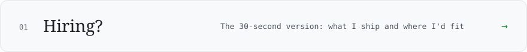
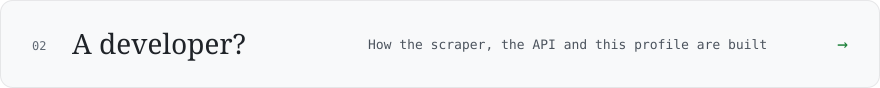
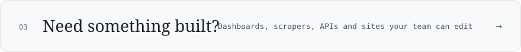
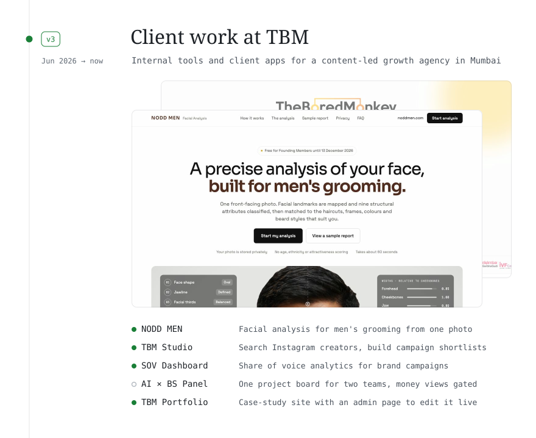
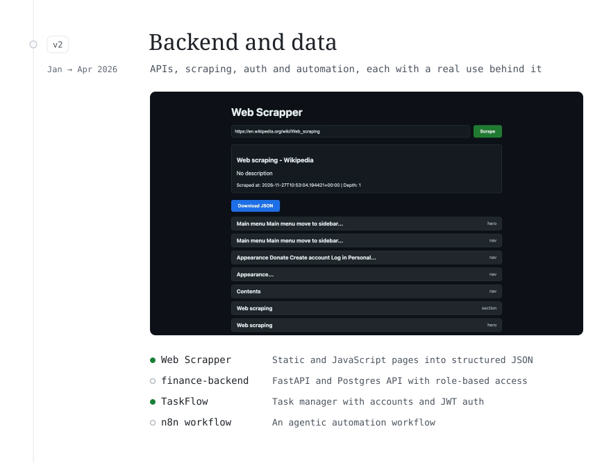
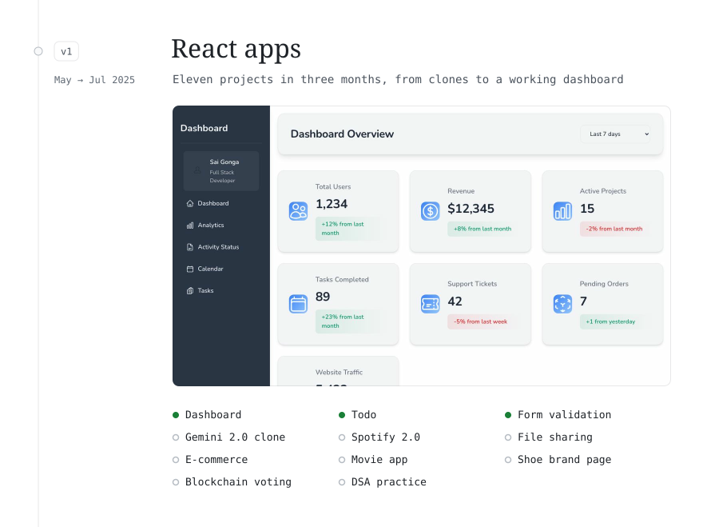
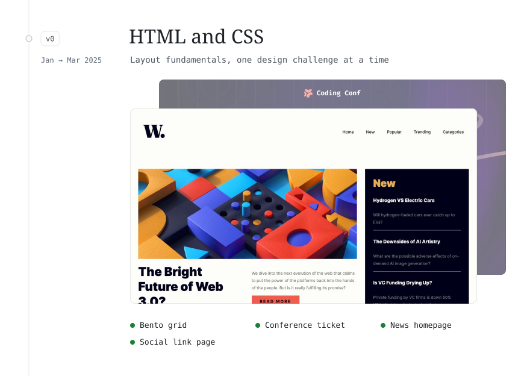
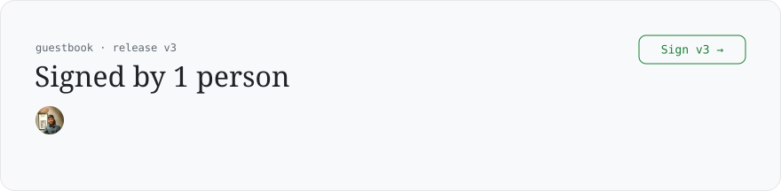

<picture><source media="(max-width: 600px) and (prefers-color-scheme: dark)" srcset="./assets/changelog-narrow-dark.svg"><source media="(max-width: 600px)" srcset="./assets/changelog-narrow-light.svg"><source media="(prefers-color-scheme: dark)" srcset="./assets/changelog-wide-dark.svg"></picture>

Passing through? <a href="#sign-the-release">Sign the v3 release</a> and your avatar lands on this page

<a href="https://github.com/saigonga/saigonga/blob/main/paths/hiring.md"><picture><source media="(max-width: 600px) and (prefers-color-scheme: dark)" srcset="./assets/path-hiring-narrow-dark.svg"><source media="(max-width: 600px)" srcset="./assets/path-hiring-narrow-light.svg"><source media="(prefers-color-scheme: dark)" srcset="./assets/path-hiring-wide-dark.svg"></picture></a>

<a href="https://github.com/saigonga/saigonga/blob/main/paths/developer.md"><picture><source media="(max-width: 600px) and (prefers-color-scheme: dark)" srcset="./assets/path-developer-narrow-dark.svg"><source media="(max-width: 600px)" srcset="./assets/path-developer-narrow-light.svg"><source media="(prefers-color-scheme: dark)" srcset="./assets/path-developer-wide-dark.svg"></picture></a>

<a href="https://github.com/saigonga/saigonga/blob/main/paths/client.md"><picture><source media="(max-width: 600px) and (prefers-color-scheme: dark)" srcset="./assets/path-client-narrow-dark.svg"><source media="(max-width: 600px)" srcset="./assets/path-client-narrow-light.svg"><source media="(prefers-color-scheme: dark)" srcset="./assets/path-client-wide-dark.svg"></picture></a>

## Releases

<picture><source media="(max-width: 600px) and (prefers-color-scheme: dark)" srcset="./assets/release-v3-narrow-dark.svg"><source media="(max-width: 600px)" srcset="./assets/release-v3-narrow-light.svg"><source media="(prefers-color-scheme: dark)" srcset="./assets/release-v3-wide-dark.svg"></picture>

Open · [NODD MEN](https://unseen-men.vercel.app) · [TBM Studio](https://instagramtbm-alpha.vercel.app) · [SOV Dashboard](https://sov-dashboard-for-tbm.vercel.app) · [AI × BS Panel](https://github.com/saigonga/BrandSolution-panel-) · [TBM Portfolio](https://tbmportfolio.vercel.app) · [NODD MEN code](https://github.com/saigonga/Unseen-Men) · three of these are private client repos, so they link to the live apps

<picture><source media="(max-width: 600px) and (prefers-color-scheme: dark)" srcset="./assets/release-v2-narrow-dark.svg"><source media="(max-width: 600px)" srcset="./assets/release-v2-narrow-light.svg"><source media="(prefers-color-scheme: dark)" srcset="./assets/release-v2-wide-dark.svg"></picture>

Open · [Web Scrapper](https://web-scrapper-kohl.vercel.app) ([code](https://github.com/saigonga/Web-Scrapper)) · [finance-backend](https://github.com/saigonga/finance-backend) · [TaskFlow](https://task-manager-flame-three.vercel.app) ([code](https://github.com/saigonga/Task-Manager)) · [n8n workflow](https://github.com/saigonga/N8N-workflow-)

<picture><source media="(max-width: 600px) and (prefers-color-scheme: dark)" srcset="./assets/release-v1-narrow-dark.svg"><source media="(max-width: 600px)" srcset="./assets/release-v1-narrow-light.svg"><source media="(prefers-color-scheme: dark)" srcset="./assets/release-v1-wide-dark.svg"></picture>

Open · [Dashboard](https://dashboard-ten-vert-29.vercel.app) · [Todo](https://todo-app-phi-steel.vercel.app) · [Form validation](https://form-validation-using-regular-expression.vercel.app) · [Gemini 2.0 clone](https://github.com/saigonga/Gemini_2.0-clone) · [Spotify 2.0](https://github.com/saigonga/Spotify-2.0) · [File sharing](https://github.com/saigonga/File-Sharing-App) · [E-commerce](https://github.com/saigonga/E-Commerce-Website) · [Movie app](https://github.com/saigonga/MovieApp) · [Shoe brand page](https://github.com/saigonga/Shoe_Brand_page) · [Blockchain voting](https://github.com/saigonga/Blockchain_based_voting_system) · [DSA practice](https://github.com/saigonga/DSA)

<picture><source media="(max-width: 600px) and (prefers-color-scheme: dark)" srcset="./assets/release-v0-narrow-dark.svg"><source media="(max-width: 600px)" srcset="./assets/release-v0-narrow-light.svg"><source media="(prefers-color-scheme: dark)" srcset="./assets/release-v0-wide-dark.svg"></picture>

Open · [Bento grid](https://projects-rouge-ten.vercel.app) · [Conference ticket](https://conference-ticket-generator-navy.vercel.app) · [News homepage](https://news-homepage-ten-omega.vercel.app) · [Social link page](https://social-link-page-one.vercel.app)

## Toolbox

| Layer | Tools |
|---|---|
| Frontend | React · Next.js · TypeScript · Tailwind · Redux · React Hook Form |
| Backend | Node · Express · FastAPI · Socket.io · JWT |
| Data | PostgreSQL · MongoDB · MySQL · Prisma · SQLAlchemy · Supabase |
| Ship | Vercel · Render · Netlify · Firebase · GitHub Actions · n8n · Playwright |

## Sign the release

<a href="https://github.com/saigonga/saigonga/issues/new?title=sign%3A%20v3&body=note%3A%20"><picture><source media="(max-width: 600px) and (prefers-color-scheme: dark)" srcset="./assets/guestbook-narrow-dark.svg"><source media="(max-width: 600px)" srcset="./assets/guestbook-narrow-light.svg"><source media="(prefers-color-scheme: dark)" srcset="./assets/guestbook-wide-dark.svg"></picture></a>

[Sign v3 →](https://github.com/saigonga/saigonga/issues/new?title=sign%3A%20v3&body=note%3A%20) It opens an issue with the title filled in. Add a note if you like, submit, and a bot adds your avatar within a minute

## Next release

Learning CI/CD pipelines and going deeper on PostgreSQL. Open to SDE roles: [LinkedIn](https://www.linkedin.com/in/sai-gonga-9623311b3/) · [Instagram](https://instagram.com/gongasai)

Fun fact
 

Don't ask

The changelog card rebuilds itself every morning from the GitHub API · [how](./scripts/changelog.py)
